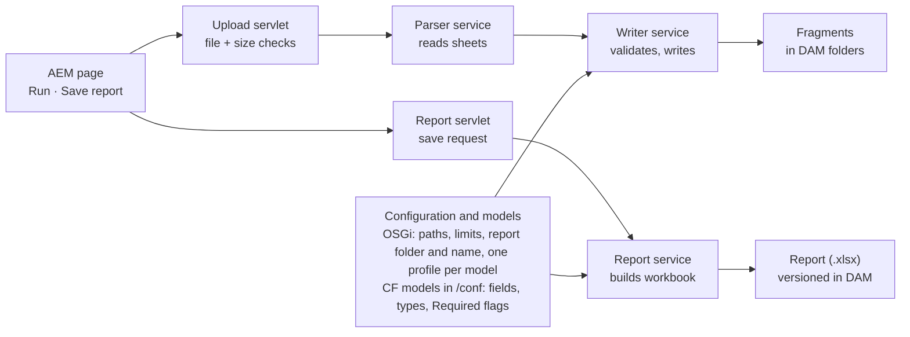

# CF Bulk Upload – Demo Brief

The SCB CF bulk upload creates and updates content fragments for six models from one Excel workbook, with a dry run, a results table and a versioned report saved to DAM. Everything below is built, deployed on local AEM (port 4507) and committed; delete, publishing and Phase 2 validation are the open topics.

> This brief describes the tool as demoed on 15 Oct 2026. The feedback from the demo was built on
> 20 Oct; see [Demo feedback and changes](#demo-feedback-and-changes-20-oct) below. The other
> documents describe the current behaviour.

## Demo feedback and changes (20 Oct)

| Feedback | Built |
| --- | --- |
| Dry Run button; Final Run enabled only after a dry run | **Dry run** and **Final run** buttons replace the checkbox and Run. Final run is enabled only after a dry run of the same workbook and folder with **no Fail rows**; the server refuses it when the workbook changed after the dry run |
| Each run saves a report with date and time in its name, in a dedicated folder | Each final run saves `cf-upload-run-<yyyy-MM-dd-HH-mm-ss>.xlsx` (results) in `/content/dam/aemcloudproject/reports`. **Save report to DAM** stays, now saving `offer-listing-report-<yyyy-MM-dd-HH-mm-ss>.xlsx` as a new file each time instead of versions (this also removes the Assets "Replace" risk that wiped the version history) |
| Users download a sample sheet and author on top of it | **Download sample sheet**: `_Guide` plus every sheet with all column names, no rows |
| Slug used only for the path; no slug field in the models; existing slug fields stay as they are | A fixed `slug` column sets the path and is not stored. The slug fields were removed from all six models in the repo (decided after the feedback); `nameField` is gone from the profiles. Because the `/conf` filter is `mode="merge"`, instances that already have the models keep the old slug fields until they are removed by hand |
| Delete option; referenced fragments give a warning and must be fixed first | `DELETE` action. Referenced (other fragments under the picked folder, pages, experience fragments) or published fragments get **Warn** and are not deleted; deletes run last, offers first |
| Offer details sorted by offer end date, descending | Saved reports sort `offer-detail` by `offerEndDate`, latest first (profile setting `sortField`) |
| Action dropdown with Create / Update / Delete | Excel dropdown on the action column of the sample and reports |
| Pathfield for the DAM parent path | **Fragment folder** picker, pre-filled from OSGi (`/content/dam/aemcloudproject/cfs/offer-listing`); profile folders are relative to it (`offers`, `merchants`, …) |

Side effect: with an empty sample sheet, new IDs now continue from the highest ID in the sheet **or in DAM**, so they no longer restart at 100001 / 1001.

## Demo script

About 15 minutes: template → dry run with errors → real run → update and clear → config.

**Prepare before the demo**

- [ ] Log in to AEM on 4507 (the local session expires; log in again just before).
- [ ] Click **Save report to DAM** once and download it: with no fragments it is an empty template with `_Guide` plus six header-only sheets.
- [ ] From it, build a demo workbook: one venue, one merchant (pointing to the venue), one category, one card, one CTA and one offer (pointing to them), plus two deliberate mistakes: a slug with a space (`Bad Slug`) and an offer without `offerTitle`.
- [ ] Upload it to `/content/dam/aemcloudproject/imports`.

**Ready (15 Oct):** two workbooks are already in `/content/dam/aemcloudproject/imports`. `demo-offers.xlsx` gives 6 Pass and 2 Fail (`Festive Bundle` slug, `lunch-special` without `offerTitle`); `demo-offers-fixed.xlsx` is the corrected copy, 8 Pass, as a fallback if you'd rather not edit live. Both only dry-run tested, nothing written.

**Show, in this order**

1. **Entry point:** Tools → **SCB Tools** → **Content Fragment Bulk Upload**.
2. **Save report to DAM:** open the file; show the `_Guide` sheet (rules, limits, generated table), the red required headers, and the asset's **Timeline** with a version per save.
3. **Dry run** of the demo workbook: green Pass rows with generated IDs (`merchantID 100001`, `offerID 100001`), red Fail rows with clear messages (`offerSlug: "Bad Slug" must be…`, `offerTitle: required`), grey Skip for untouched sheets, **Download CSV**. Point out that nothing was written.
4. Fix the two rows, upload again, **untick Dry run, Run**: fragments appear in Assets, in their folders.
5. **Update and clear:** Save report again (now with rows), set `UPDATE` on the CTA, change its label and empty `deeplink` → dry run shows `(cleared: deeplink)` → real run.
6. **Configuration:** `/system/console/configMgr` → **SCB CF Model Profile** (one per model) and **SCB CF Bulk Upload** (paths, limits, report folder and name). A new model needs one config file, no code.
7. **Authoring Guide** document for authors.

**Messages to land:** checks before writing; dry run by default; per-row results; config-driven models; no delete or publish by design (yet).

## Test scenarios

Every scenario below was run on 15 Oct with the result shown; 4507 was cleaned afterwards. Files are in `/content/dam/aemcloudproject/imports`. **Before:** works on an empty instance. **After:** needs the real run of `demo-offers-fixed.xlsx` first.

| # | Scenario | File | When | Expected result |
| --- | --- | --- | --- | --- |
| 1 | Empty template | Save report to DAM | Before | `_Guide` + 6 header-only sheets, red required headers; version in Timeline |
| 2 | Create a full set, with mistakes | demo-offers.xlsx (dry run) | Before | 6 Pass with IDs (merchantID 100001, ID 1001, offerID 100001); 2 Fail: slug `Festive Bundle`, `offerTitle: required` |
| 3 | Create a full set | demo-offers-fixed.xlsx (dry run, then real run) | Before | 8 Pass; offers 100001–100003; fragments in their folders |
| 4 | Whole workbook rejected | demo-workbook-errors.xlsx | Any | Red alert listing all 3: header with a space, action `UPDTE`, sheet without `action`; nothing checked or written |
| 5 | Pick a folder or a non-Excel file | Path field: choose the imports folder itself; for a non-Excel file, upload any image or PDF to /imports first | Any | "… is not a DAM asset" / "… is not an .xlsx file" |
| 6 | Run the same CREATE twice | demo-offers-fixed.xlsx again | After | Every row Fail: "Fragment: already exists at …" |
| 7 | Update, clear, partial columns, `_Notes` | demo-updates.xlsx | After | Venue Pass `(cleared: ophr)`; CTA Pass `(cleared: deeplink)`; offer Pass; category Skip; lowercase `update` accepted; `_Notes` ignored |
| 8 | Row errors, the rest still runs | demo-row-errors.xlsx | After | 1 Pass + 10 Fail: already exists, not found, `offerTitle: required` (emptied on UPDATE), `10001a` not a whole number, `maybe` not yes/no, `01/11/2026` not a date, two CTAs, `#CLEAR` no longer used, `promoCode` not a field, sheet `offers` not a known model |
| 9 | Report with data | Save report to DAM | After | Rows per sheet, sorted by ID; new version in Timeline |
| 10 | Re-upload the report unchanged | The saved report | After | `_Guide` ignored, every sheet Skip, status ok |

**Tip for the demo:** scenarios 2 → 3 → 7 → 8 tell the story in about 10 minutes. Remember that after scenario 3 the fragments exist, so re-running 2 or 3 gives "already exists".

## What's built

All of this works end to end on 4507 and is committed (latest commit `3dfd6ef`).

| Area | Feature |
| --- | --- |
| Workbook | `.xlsx` from DAM; one sheet per model; row 1 = field names; `action` column with CREATE / UPDATE (any case); blank-action rows skipped; sheets starting with `_` ignored |
| Values | Text, rich text (HTML), whole and decimal numbers, yes/no, dates (with or without time zone), single and multiple fragment references (one path per line), image and link references |
| Clearing | On UPDATE an empty cell clears the field (except the ID); columns left out are untouched; results list `(cleared: …)`; `#CLEAR` retired and rejected |
| IDs | Automatic on CREATE: highest ID in the sheet + 1, per model; start values 100001 (offers, merchants) and 1001 (categories, cards); works for number and text IDs; failed rows don't use an ID |
| Checks before writing | Slug rule; columns must be model fields; required fields (from the model's Required flag); CREATE needs a free path, UPDATE an existing fragment of the same model; values must convert |
| Safety | Dry run on by default; each row saved on its own (one bad row never undoes others); limits 10 MB and 5,000 rows with an action; workbook-level errors stop everything before any write |
| Results | Table with sheet, row, slug, action, Pass / Fail / Skip and details; failures first; counts; CSV download |
| Report | **Save report to DAM**: one sheet per model (header-only when empty, so it's a template), `_Guide` first sheet, required headers in red, rows sorted by ID; saved to a fixed file in a configured folder; the previous file kept as a version (Timeline) |
| Configuration | OSGi: fragment root, models path, report path, report folder and file name, limits; one **model profile** per model (folder, slug, title, ID field, start ID, sheet order) |
| Models | Six models aligned with the SCB reference (offer-detail 29 fields, offer-card `ID`, text `merchantID`, single `offerCta`, …) |
| Entry point | Tools → SCB Tools → Content Fragment Bulk Upload |
| Docs | Spec in the repo; Authoring Guide for authors; `_Guide` sheet in every report |

## How it fits together

Both flows read the same configuration and models, so a new model or a newly required field changes the upload checks and the report together.

| Part | Class |
| --- | --- |
| Upload servlet | `ScbCfBulkUploadServlet` (POST `upload.json`) |
| Parser service | `ScbWorkbookParserService` / `ScbWorkbookParserServiceImpl` |
| Writer service | `ScbContentFragmentWriterService` / `ScbContentFragmentWriterServiceImpl` |
| Report servlet | `ScbCfReportServlet` (POST `report.json`) |
| Report service | `ScbContentFragmentReportService` / `ScbContentFragmentReportServiceImpl` |
| Configuration | `ScbCfBulkUploadConfiguration`; `ScbModelProfileConfiguration` + `ScbModelProfile` / `ScbModelProfileImpl` (one per model) |
| Shared helpers | `ScbCfBulkUploadUtil` (Required flags, folder creation); `ScbSheetData` (parsed sheet) |
| Page | Granite page `/apps/aemcloudproject/cfbulkupload/content/cfbulkupload.html` + clientlib `cf-bulk-upload.js` / `.css` |

## Key decisions taken

Most decisions trade flexibility for safety and simplicity for authors.

| Decision | Why |
| --- | --- |
| Built from scratch instead of the ACS Commons CF importer | ACS gave poor error reporting, weak field-type handling, timeouts and setup overhead |
| Excel `.xlsx` picked from DAM, one sheet per model | Familiar to authors; the sheet name is the model name, so no mapping file |
| Only CREATE and UPDATE; delete stays manual | Delete is irreversible; on hold until the lead decides (see Open decisions) |
| Dry run ticked by default, no confirmation popup | Every run is a safe check unless the author deliberately unticks it |
| All checks before writing; each row saved on its own | A bad row never half-writes a fragment or undoes good rows |
| Empty action = row skipped; no actions in a sheet = Skip line | A full report can be re-uploaded with only a few rows changed |
| Empty cell on UPDATE clears the field; `#CLEAR` retired | Lead's proposal: the report holds current values, so deleting a value means "remove it" |
| IDs: highest in the sheet + 1, start values per model | No AEM lookup needed; works when the sheet contains the existing rows |
| Required fields come only from the CF model | One source of truth; authoring UI and upload enforce the same rules |
| Paths, limits and model profiles in OSGi config | A new model or environment needs config, not code |
| Report saved to DAM (fixed name, previous file versioned) instead of downloaded | Shared location, history in the Timeline; uses `AssetManager` for now |
| Report is also the template (header-only sheets, `_Guide` first) | Authors always start from a correct workbook; sheets starting with `_` are ignored |
| No Sling Job (synchronous upload) | Not needed at current volumes; limits guard against timeouts |
| Models aligned to the SCB reference; existing local fragments deleted | The photos of the SCB models are the source of truth |
| Concise Javadoc only; `scb` only in class, method, JS and CSS names | Team conventions |
| Report's slug column = the fragment's node name, not the stored field | The slug is how UPDATE finds a fragment. Legacy fragments with an empty slug field, and fields edited by hand, still round-trip correctly; an UPDATE back-fills or resets the field (tested 15 Oct) |

## Risks and limitations flagged

The top three for a real rollout: model changes don't deploy to existing environments, there is no undo, and references aren't checked.

| # | Risk or limitation | Impact | Mitigation today / proposed |
| --- | --- | --- | --- |
| 1 | `/conf` filter is `mode="merge"` | Model changes in `ui.content` never update models that already exist on stage or prod | Decide the deployment approach for models before going beyond local |
| 2 | No undo after a real run | A valid but wrong workbook overwrites values | Dry run, `(cleared: …)` notes, report versions as "before" snapshot; proposed: versions before UPDATE, backup workbook per run |
| 3 | References not checked | A path to a missing fragment or image is saved as is; broken links on the frontend | Phase 2 reference check |
| 4 | Duplicate IDs possible | IDs come from the sheet only; a workbook without existing rows, or a typed ID, can repeat an ID | Always start from a fresh report; Phase 2 duplicate check (against AEM too) |
| 5 | Duplicate slugs in one workbook | Two CREATE rows both pass in a dry run; two UPDATE rows: the last one wins | Phase 2 duplicate check |
| 6 | Header problems surface per row | A wrong column fails every row; a misspelt slug header shows a misleading slug message; a blank header's column is silently ignored | Phase 2: one header check per sheet, clearer slug messages |
| 7 | Synchronous upload | Very large uploads can hit the Cloud request time limit (roughly a minute) and lose the results | Limits (10 MB, 5,000 rows); measure \~500 rows and lower the limit if needed; Sling Job if bulk loads become common |
| 8 | `AssetManager` is deprecated on Cloud | Saving the report could be restricted later | Works today; direct binary upload is the documented replacement |
| 9 | Excel date cells | A real Excel date turns into Excel's display format and fails | Guide tells authors to type dates as text |
| 10 | Nothing is published | New and changed fragments stay on author until someone publishes | Manage Publication with "include references"; proposed: publish step in the tool |
| 11 | Servlets also deploy to publish | Low risk: the dispatcher blocks `/apps` | Restrict them to author |
| 12 | Fragment metadata, variations, language copies | Only master content and the title are set | Out of scope unless needed |
| 13 | Multi-value fields that aren't paths | Several values in a text field can't be uploaded | Not needed for the current models |
| 14 | Permissions | Authors need write rights on the fragment, imports and report folders | Check groups before rollout |

## Open decisions

These are waiting on you or the lead; each has a suggestion ready.

| Topic | Question | Suggestion |
| --- | --- | --- |
| Delete | Decided and built 20 Oct: real delete, referenced or published fragments left in place with Warn, dry-run gate as the safeguard | Open: may a deleted fragment's ID be reused? |
| Publishing | How to publish exactly what a run wrote | Now: Manage Publication with "include references", checked against the run's CSV. Later: a "Publish N written fragments" step with confirmation |
| Rollback | Versions before every UPDATE? Backup workbook per real run? Restrict real runs to a group? Show before → after values in the dry run? | Versions before UPDATE + before/after in the dry run first |
| Duplicates | Fail only the rows involved? Include rows without an action? Check IDs against AEM? (IDs are now generated from sheet + AEM) | Yes to all three |
| Headers vs model | Bad headers reject the workbook or the sheet? "Did you mean" hint? Check skipped sheets? | Reject the workbook, add the hint, ignore skipped sheets |
| Slug messages | Separate messages for missing column, empty, invalid, several lines; "e.g." hint? | Yes, with the hint; missing column fails that sheet |
| Models on other environments | How to deploy model changes despite `mode="merge"` | Decide with the team before stage |
| UI colours | Blue / green / red banners for dry run vs real run; tinted Fail rows; AEM status colours; brand background (removed again) | Banners + Fail tint |
| Sling Job | Background uploads with progress | Skip until real bulk loads need it |

## Doubts still to verify

None of these block the demo; they need a check before a real rollout.

- [ ] **Excel date cells:** the guide says type dates as text; a real Excel date cell hasn't been tested yet.
- [ ] **`AssetManager` on Cloud:** saving the report works on the local SDK; confirm once on a Cloud dev environment.
- [ ] **Cloud request time limit:** time a real upload of about 500 rows to know how far 5,000 is from the limit.
- [ ] **Publishing options:** exact names of the tree-publish "only modified" options on your Cloud version.
- [ ] **Version purge:** report versions accumulate; confirm AEM's version purge settings on each environment.
- [ ] **Author permissions:** which groups can write in the fragment, imports and reports folders.
- [ ] **Model details from the photos:** `merchantLogo` as boolean, `preview` / `cache` as model fields (they may come from the Java model), and the label "offer Location" with a lowercase o were taken as shown; confirm with the source XML if available.
- [ ] **Header with a space and conversion errors** (`10001a`, `maybe`) haven't been run on the new models yet.
- [ ] **Local leftovers:** version 1.0 of the saved report has no label (from an early test), 22 old test workbooks sit in `/imports`, and empty folders remain under `offer-listing`.

## Next steps

Suggested order after the demo: decide the deployment of models, close the data-safety gaps, then add convenience.

1. **Deployment readiness:** settle how model changes reach stage and prod; restrict the servlets to author; check author permissions; confirm `AssetManager` on a Cloud dev environment.
2. **Phase 2 validation:** duplicates (IDs and slugs), clearer slug messages, header check per sheet, then reference checks.
3. **Safety:** versions before UPDATE and before → after values in the dry run.
4. **Publishing:** start with Manage Publication; build the publish step if uploads become regular.
5. **Delete:** built 20 Oct; open: whether deleted IDs may be reused.
6. **Quality:** JUnit tests (deferred until the design is final), remaining tests (date cells, header with a space, conversion errors), local clean-up.
7. **Later / optional:** Sling Job for very large uploads, multi-value text fields, fragment metadata or variations, report walking every profile folder, UI colour polish.

## Related documents

- [CF Bulk Upload – Authoring Guide](02-authoring-guide.md): for authors, first time to everyday use.
- [CF Bulk Upload – Delete Challenges](06-proposal-delete-challenges.md): decided and built 20 Oct.
- [CF Bulk Upload – Empty Cell Clears Field](05-decision-empty-cell-clears-field.md): decided and built.
- [Input format (spec)](01-input-format.md): the contract the code implements.
- [Test scenarios](03-test-scenarios.md): every scenario with its workbook rows and verified result.
